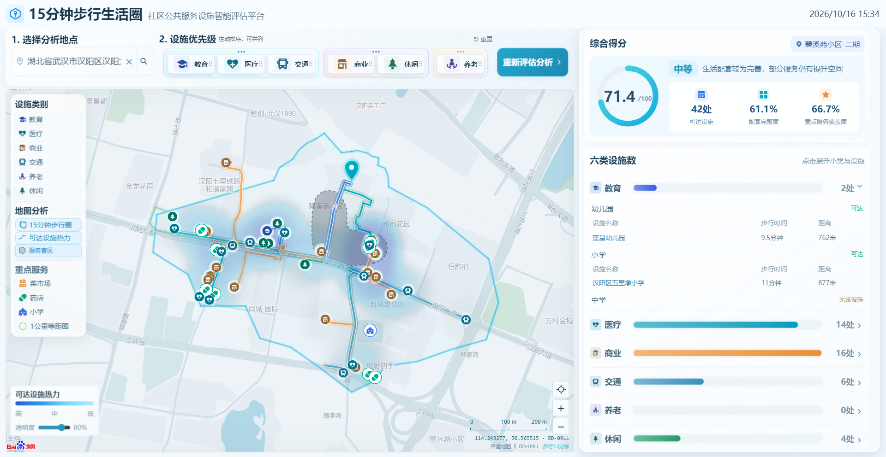
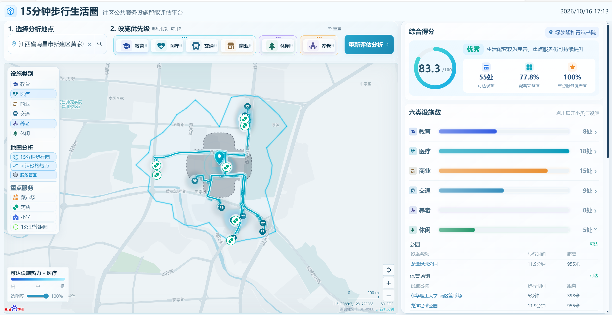
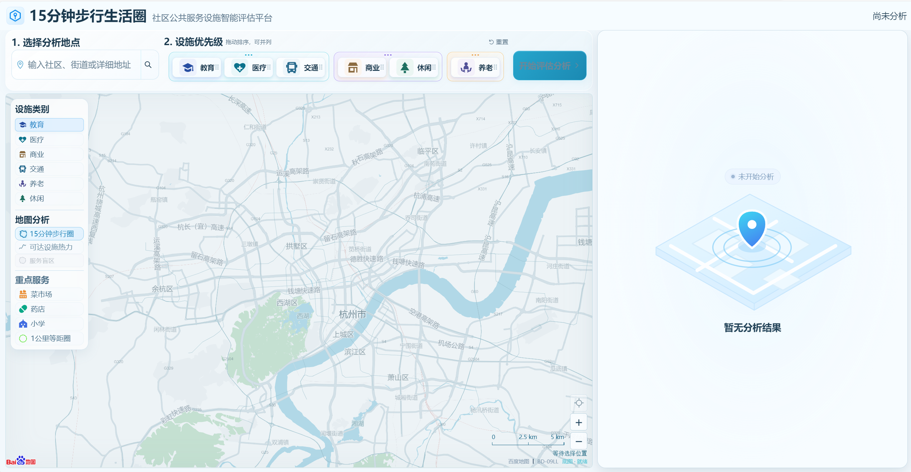
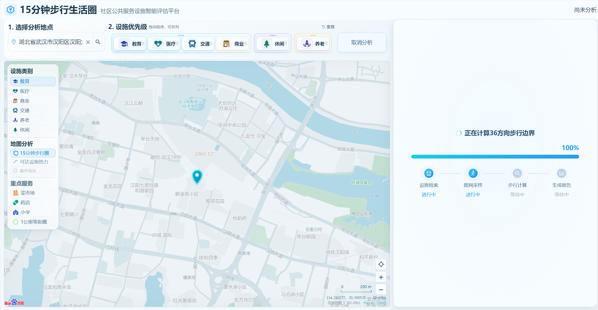

# 15分钟步行生活圈 WebGIS

**用真实步行路线，理解社区公共服务的可达性。**

基于百度地图开放平台的社区设施评估工具：选择地点、调整设施优先级，生成15分钟步行范围、六类设施统计、18小类覆盖评分、1公里重点服务与六大类服务盲区。用于百度地图开放平台开发者大赛。

**[三地测试验证 →](docs/validation/README.md)** · [技术设计](docs/TECHNICAL_DESIGN.md) · [API](docs/API.md) · [项目审查](docs/PROJECT_AUDIT.md) · [MIT许可](LICENSE)

> 截图来自本项目实际BMapGL页面与保存的真实分析，数据时间、来源和局限见三地报告。当前版本没有报告导出、天气或生鲜替代服务入口。

## 核心功能

| 模块 | 当前实现 |
| --- | --- |
| 步行范围 | 36方向真实Walking成本采样，原始折线，有限预算方向补点，可回退 |
| 设施检索 | 百度Place多关键词分页，UID去重、规则分类、检索完整性证据 |
| 覆盖与评分 | 六大类18小类，真实Walking≤1200m，P1/P2/P3加权覆盖 |
| 重点服务 | 菜市场、药店、小学独立1km Walking统计，全量与最近路线联动 |
| 地图解释 | 分类路线、柔光与流光、紧凑POI卡片、真实步骤通行节点、可达设施热力 |
| 服务盲区 | 仅六大类，200m网格、四邻接聚合、Marching Squares、单次灰面并集与分类悬停 |
| 可追溯性 | 起终点绑定、证据指纹、归档校验、缓存与OD/HTTP分别计量 |

### 技术亮点

- **边界与评分解耦**：圈外但真实Walking可达仍计入；多边形内的超距设施不误计分。
- **POI引导的少量真实补点**：复用已知成本找漏包，最多默认18 OD；自交、误包、外扩异常回退。
- **成本与路径分离缓存**：矩阵不伪装路径，按坐标、UID、API与导航策略区分，持久化TTL和在途去重。
- **可解释空间诊断**：完整性不足不硬判缺失；并集面积去重，当前位置悬停仅列实际命中类别。
- **轻量工程**：Node标准库、原生ES Modules，无生产npm依赖；本地一键运行与离线回归。

边界为有限径向采样近似，盲区没有逐网格Walking测量；不宣称全域精确覆盖。参见[技术设计与局限](docs/TECHNICAL_DESIGN.md)。

## 快速启动

需要 **Node.js 20+** 和支持WebGL的现代浏览器。核心运行、构建和单元测试不需要安装npm依赖。

~~~sh
git clone https://gitee.com/heqidi/15min-living-scape.git
cd 15min-living-scape
# Windows: copy .env.example .env.local
# Linux:   cp .env.example .env.local
npm start
~~~

打开 **http://127.0.0.1:4173**。首次启动若没有.env.local，会自动创建空AK配置；启动前也可手动复制并填写。

| 配置 | 用途 |
| --- | --- |
| VITE_BAIDU_MAP_AK | 浏览器端JSAPI AK，配置自己的Referer白名单 |
| BAIDU_SERVER_AK | 服务端Place/Walking AK，配置实际出口IP白名单 |
| BAIDU_WALKING_SAMPLING_FALLBACK_ENABLED=true | 使用当前Walking径向采样 |
| BAIDU_BATCH_WALKING_ENABLED | 默认false；自己确认矩阵权限后启用 |
| BAIDU_BATCH_WALKING_VALID_UNTIL | 自己账户实际矩阵授权日期；空值不授予权限 |

**当前评审演示配额有效期至2026年10月30日（维护者提供）**。这不是开源使用者的额度承诺；仓库不附带真实AK。到期或换账号后按自己的授权配置，不通过提高本地参数突破平台配额。

### 三地保存记录演示

~~~sh
npm run demo:prepare
npm start
~~~

prepare命令输出三个可打开的分析链接，离线解压并核验快照，不调用Place/Walking。底图仍需自己的浏览器AK和网络；快照为只读历史结果，不能冒充新分析。杭州为历史参考定位点。

## 测试与构建

~~~sh
npm test                 # 完整维护测试，无真实API
npm run verify:records   # 三地历史记录、路线、评分和六类盲区回放
npm run verify:http      # 无AK启动、HTTP契约与静态资源检查
npm run check            # 发布清单、密钥形态、模块与文档链接
npm run build            # 执行全套维护测试后输出源码ZIP/SHA-256/清单
~~~

Windows可双击start.cmd / test.cmd / build.cmd；Linux可执行sh start.sh / sh test.sh / sh build.sh。脚本使用同一Node入口。实际验证成绩、失败修复及环境见[本次验收](docs/validation/RELEASE_VERIFICATION.md)；Linux脚本可移植，但未在真实Linux主机上运行的部分会明确标记。

浏览器验收需可选Playwright和配置好的本地服务，安装及执行见[验证指南](docs/validation/README.md)。不默认发起付费实时检索。

## 系统架构与目录

~~~text
server/       HTTP接口、任务、检索、Walking、缓存、评分及证据
web/          BMapGL地图、路线、图表、布局与交互
data/         版本化分类、测试夹具、有限压缩真实快照
test/         维护中的离线回归（含明确标注的历史兼容测试）
scripts/      跨平台启动/构建/检查/回放与必要测试夹具
docs/         技术设计、三地验证、截图及标注版本的历史证据
dist/         构建输出，不提交Git
~~~

主链路：选择地点 → 任务 → 分页检索及36方向采样 → 分类去重 → 真实Walking → 覆盖评分 → 同源快照 → 地图与六类盲区。完整数据流、公式、API和保护条件见[技术设计](docs/TECHNICAL_DESIGN.md)。

## 开源说明

主项目 **MIT**。ECharts、MapVGL及百度地图服务分别遵循原许可与协议，见[第三方说明](THIRD_PARTY_NOTICES.md)。公共POI和路线快照不是独立开放数据集。真实AK、.env.local、运行额度与缓存、调试日志、无关资料和历史构建包不在发布清单中。

[参与开发](CONTRIBUTING.md) · [安全与部署](SECURITY.md) · [历史算法结论](ISOCHRONE_EXPERIMENT_CONCLUSION.md)
