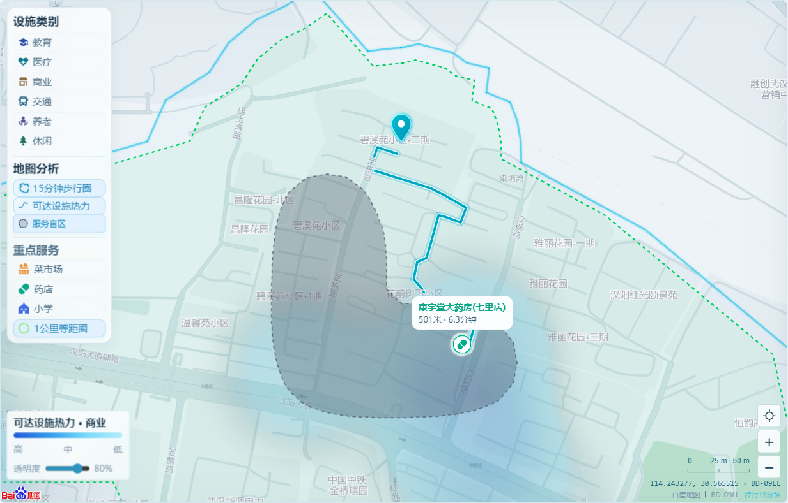
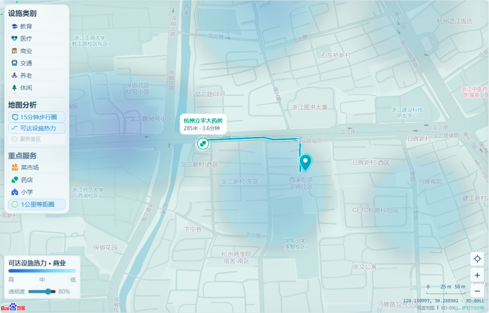
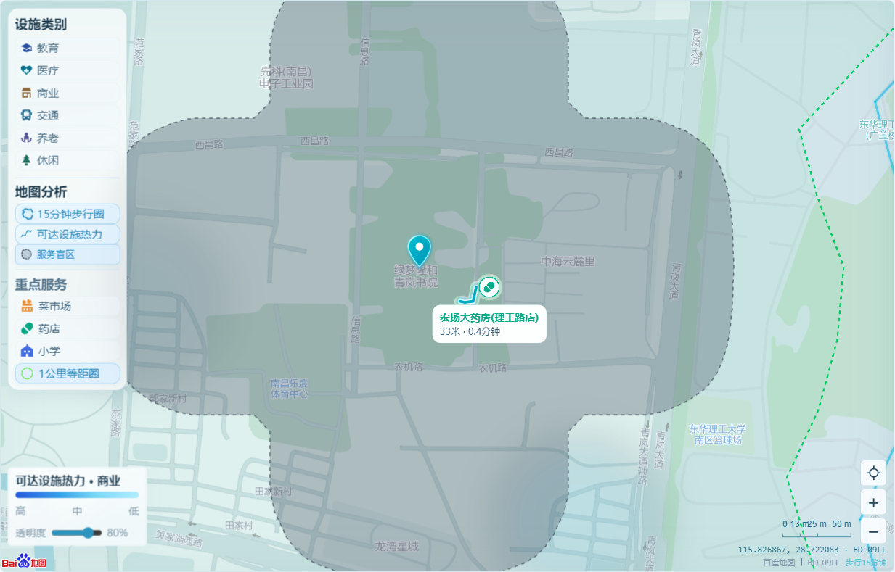

# 三地真实记录复核

日期：2026-10-16；模式：保存证据回放，新增Place/Walking均为0。原始历史报告与当前结果分别保存，不覆盖旧成绩。

| 地点 | 可达UID数 | 综合分 | 教育/医疗/商业/交通/养老/休闲 | 有效路径 | 盲区 |
| --- | ---: | ---: | --- | ---: | --- |
| 武汉汉阳碧溪苑二期 | 42 | 71.43 | 2 / 14 / 16 / 6 / 0 / 4 | 42 | eldercare |
| 杭州西溪文锦（历史参考定位点） | 99 | 90.28 | 12 / 30 / 25 / 18 / 2 / 12 | 99 | 无已确认盲区 |
| 南昌绿梦隆和青岚书院 | 55 | 82.14 | 9 / 18 / 15 / 9 / 0 / 4 | 55 | eldercare |

大类数量可交叉归属，UID总数去重；圈内位置不替代真实Walking。历史杭州点是参考坐标。

## 武汉汉阳碧溪苑二期

- ID：`fa-fa100817-5662-f190-2afb-c73f61ce1d74`
- BD-09：114.24327745799232, 30.565515230077406
- 来源完成时间：2026-10-16T07:34:09.925Z
- 来源规则：six-group-public-services-v8.6；离线归类回放，来源ID fa-01a23537-ee50-4105-a7cb-3bfbc6d009d0。
- 等时圈总面积：0.977761 km²；可判定域：0.400000 km²。
- 灰面并集：0.068223 km²；可判定域内占比：17.06%。

| 重点服务 | 1km内数量 | 最近有效距离(m) | 内部证据状态 |
| --- | ---: | ---: | --- |
| 菜市场 | 0 | 1310 | absent_in_declared_search |
| 药店 | 4 | 501 | present |
| 小学 | 1 | 877 | present |

重点设施不进入当前盲区。完整性不充分时0处不等于已确认缺失。

## 杭州西溪文锦（历史参考定位点）

- ID：`fa-65023c6c-a392-28bb-47c5-5bd8266155d8`
- BD-09：120.150993, 30.288902
- 来源完成时间：2026-10-14T08:21:54.955Z
- 来源规则：历史结果，未重新分类；保留历史任务分类与检索状态。
- 等时圈总面积：2.706998 km²；可判定域：2.706998 km²。
- 灰面并集：0.000000 km²；可判定域内占比：0.00%。

| 重点服务 | 1km内数量 | 最近有效距离(m) | 内部证据状态 |
| --- | ---: | ---: | --- |
| 菜市场 | 0 | — | unknown |
| 药店 | 8 | 285 | present |
| 小学 | 5 | 147 | present |

重点设施不进入当前盲区。完整性不充分时0处不等于已确认缺失。

## 南昌绿梦隆和青岚书院

- ID：`fa-7f6f794b-25bd-46d6-a03d-3d8983d50169`
- BD-09：115.82686707870968, 28.722082834218497
- 来源完成时间：2026-10-14T16:16:43.042Z
- 来源规则：历史结果，未重新分类；保留历史任务分类与检索状态。
- 等时圈总面积：1.975453 km²；可判定域：1.160000 km²。
- 灰面并集：0.391872 km²；可判定域内占比：33.78%。

| 重点服务 | 1km内数量 | 最近有效距离(m) | 内部证据状态 |
| --- | ---: | ---: | --- |
| 药店 | 4 | 33 | present |
| 小学 | 5 | 676 | present |
| 菜市场 | 1 | 944 | present |

重点设施不进入当前盲区。完整性不充分时0处不等于已确认缺失。

## 方法与局限

压缩快照保留真实成本、路径及盲区证据并移除冗余原始字段。制作时分别与完整来源比较了六类网格mask、assessedMask、轮廓、并集面积、评分和UID数，全部一致。sourceSHA256标识当时读取的完整JSON，snapshotSHA256标识公开精简投影；二者不应相同。

历史原始检索状态partial保留，不补写成功，不用新分类规则伪造缺少的路线。当前verify:records不访问网络。真实通行节点接口仅在历史报告中验证，本轮浏览器复验禁用该POST。
